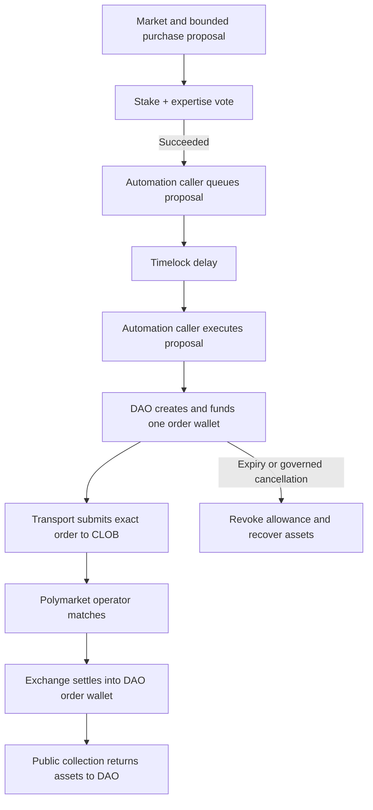

# A market-governed Polymarket DAO

This project connects Prestifilippo's governance to collective market actions.
A market is the topic, a proposal fixes a purchase, and a successful vote
authorizes an order funded and controlled by DAO contracts. The primary
prototype removes the need for an executor to hold the DAO's trading key or
receive its funds in a personal wallet.

## Governance inherited from Prestifilippo

Membership, EIP-712 credentials, checkpointed skill scores, topic quorum and
superquorum, Governor and Timelock are preserved. The source revision and
adaptation are in [UPSTREAM.md](UPSTREAM.md).

```text
votes(member, market, snapshot) = stakeVotes(member, snapshot)
                              + skillVotes(member, domain(market), snapshot)
```

The topic is `uint256(conditionId)`. An immutable registry maps it to outcome
tokens and an expertise domain. Both voting components use the proposal
snapshot. A proposer cannot attach a direct order to another market's electorate;
a voter cannot supply a replacement topic. The four technology domains and
eight skills are retained. Sports or politics need an explicit credential/
relevance model. Governance admits market metadata; the registry does not
independently authenticate Gamma's condition/outcome mapping.

## Contract flow



The trigger is the governance outcome. The prediction market resolves later,
determining the position's payout. Future deployments use `RedeemableOrderVault`:
the market electorate approves a `redeem(market)` proposal, and the Timelock
calls the fixed adapter through the vault after genuine resolution. The adapter
pays pUSD to the vault. A caller executing that single action through the Governor
receives bounded reimbursement from a separately voted treasury POL allocation.
The vault reserves that allocation and unpaid refund credits against native
withdrawals. Existing deployed vaults retain their original behavior. See
[the governed redemption design](docs/dao-funded-redemption-2026-10-02.md) and
[the historical live receipt](docs/redemption-live-2026-10-02.md).

`GovernanceAutomation` exposes a resolver returning `(canExec, execPayload)`
and a public `advance` method. Any sender may queue a succeeded proposal or
execute a queued proposal after the delay. The transaction rechecks readiness.
An external service evaluates the resolver and supplies transaction gas. It
receives no governance role. The Governor's queue/execute rules still apply.
[OpenZeppelin governance](https://docs.openzeppelin.com/contracts/5.x/governance).

`OrderVault.authorizeOrder` checks the registered outcome, deadline, exchange,
unused ID and unreserved funds. It creates one `OrderWallet` and sends only
the principal plus fee budget. That wallet approves only the configured
exchange, up to that amount. Each order has separate custody and allowance;
transport cannot spend the treasury or change the approved outcome or amounts.

The wallet constructs one V2 EIP-712 order: itself as maker and signer, BUY
side, `POLY_1271`, the top 53 bits of the intent ID as salt (the SDKs keep salts
JSON-safe) and the full ID as metadata, creation time in milliseconds,
zero builder code. The digest includes chain and exchange domain.
`isValidSignature` accepts only this digest with marker `0x01` while active
and within the deadline. The marker is public. Contract state supplies the
authorization without a private key held by the transport.
[V2 order structure](https://github.com/Polymarket/ctf-exchange-v2/blob/main/src/exchange/libraries/Structs.sol),
[V2 hashing](https://github.com/Polymarket/ctf-exchange-v2/blob/main/src/exchange/mixins/Hashing.sol).

The exchange enforces price, cumulative fills and its fee rules. The wallet
caps total collateral spending, without calculating a separate per-fill fee
limit. Partial fills are possible. FOK is an offchain policy and is not enforced
by the wallet's digest. The transport's API order type therefore does not add
an onchain all-or-nothing guarantee.

The deployed standard exchange reported `getMaxFeeRate() = 0` on the Polygon
fork, and V2 treats zero as no fee limit. The operator chooses the fee of each
match, so the wallet's principal plus fee budget is the only bound on what an
order can cost. The fork rehearsal charged a 1% fee within the budget and saw a
fee one unit above the budget fail.

## External trigger and transport

Contracts do not wake themselves up when time passes. An existing transaction
can trigger another contract call, but a vote deadline and Timelock usually
need later transactions. An automation service can supply those calls without
receiving discretion over what to buy.

Polymarket also requires offchain order submission and matching. The published
V2 `matchOrders` entry point is operator-only. A DAO cannot use it as a
permissionless market-buy function or make an HTTP request to the CLOB. The
intended transport carries the exact approved order.
[Polymarket order lifecycle](https://docs.polymarket.com/concepts/order-lifecycle),
[exchange entry point](https://github.com/Polymarket/ctf-exchange-v2/blob/main/src/exchange/CTFExchange.sol).

The Worker in `automation/` supplies both the transactions and the transport.
Its gas key can only pay for permissionless calls: `advance` on the automation
contract and `collect` on an order wallet. The design choices that bound it:

- **Stages fail independently.** Discovery, governance and transport errors are
  reported per stage or per item. Cleanup of known wallets runs even when log
  discovery fails, and a proposal whose execution would revert does not block
  the next one. Collection runs before governance and transport.
- **One pending nonce.** The service signs and persists the exact bytes before
  broadcasting. At 32 confirmations it records the actual fee. Bytes the RPC
  lost are sent again unchanged. A transaction the node refused, or one still
  priced below current fees after about one cron interval, is replaced on the
  same nonce with at least 12.5% higher fees. A refused or unrepriceable
  transaction is reported as an issue and stops new order posts. A nonce used
  by another sender at confirmed depth is released only when the RPC knows none
  of the signed versions. With execution disabled nothing is broadcast,
  including stored bytes.
- **A budget with a cleanup reserve.** Confirmed fees plus the pending worst case
  (gas limit × fee cap) never exceed `MAX_TOTAL_GAS_WEI`. Governance
  transactions must leave enough budget to collect every open wallet whose
  order was posted, when they are sent and when they are repriced. If a
  repricing would spend that reserve, the governance transaction is cancelled
  with a same-nonce self-transfer and the action is retried once it is ready
  again. A new post needs budget for one more cleanup. The bound is 200,000 gas
  per collection. On the fork a first collection with both transfers estimated
  129,012 gas, so the Worker would sign a 154,814 limit; it used 109,361.
- **Fees from the configured RPC.** Ethers' Polygon preset prices transactions
  from an external gas station. The Worker uses a plain network definition, so a
  gas-station outage cannot block cleanup. The tip is at least the node's legacy
  gas price minus the base fee, because ethers otherwise falls back to 1 gwei
  when `eth_maxPriorityFeePerGas` is unavailable.
- **Reverts per step.** A mined revert counts against its action label.
  Governance labels include the proposal state, so queue and execute are counted
  separately. After two reverts the step waits for review.
- **One post per digest.** The exchange caps fills per digest, so repeating the
  exact order cannot overspend. Resubmitting a killed FOK order is still a
  policy decision, and an uncertain post stays `unknown`. The Worker records the
  CLOB's own record by digest and the exchange's `orderStatus`, which shows what
  actually settled. The posted order follows the SDK's FOK shape: principal
  and shares in hundredths, and the price an exact tick multiple.

The geoblock check runs from the Worker's egress location. Cron invocations can
run in different Cloudflare locations, so the answer can vary and says nothing
about the DAO operator's jurisdiction.

Splitting collateral into YES and NO is onchain, but retaining both does not
create the exposure of buying one side. A secondary onchain venue could provide
that exposure if verified liquidity existed for the same tokens. No such
liquidity is assumed here.
[Position mechanics](https://docs.polymarket.com/trading/positions/how-positions-work).

## Cancellation, expiry and recovery

The published exchange lets its operator cache a valid approval and later
omit the signature. A cached order skips the wallet's current ERC1271 answer.
Signature invalidation alone therefore cannot guarantee that spending stops.
[Signature validation](https://github.com/Polymarket/ctf-exchange-v2/blob/main/src/exchange/mixins/Signatures.sol).

`collect()` becomes permissionless when the requested position balance arrives
or the deadline passes. `cancelOrder(id)` needs a Timelock action approved
through governance. Both close the wallet, revoke the exchange allowance and
return actual shares and remaining collateral to the immutable DAO treasury.
Anyone can recover late donations to that same recipient. Recovery never
reopens the order or renews its allowance.

**The deadline is not a hard autonomous cutoff for cached spending.** A cached
order may fill until cleanup is included. Governed cancellation also takes
effect at execution and may lose a race to settlement. Tests reproduce the
cached-expiry window and demonstrate that allowance revocation stops later
spending, including after additional deposits. The fork rehearsal reproduced it
on the deployed exchange: after the deadline the wallet's signature was invalid
and `validateOrder` rejected the order, yet a preapproved copy with an empty
signature filled half of it. After collection, the next cached fill failed.
Live operation needs a funded cleanup task that continues even when submission
or matching fails.

The full-position check uses balances. Donated inventory could make a wallet
collectible without any purchase; the DAO would receive that position and
recover unspent collateral. This must not be described as a verified venue
fill. Exchange receipts provide separate historical evidence.

## Implementation and integration status

| Component | Status |
| --- | --- |
| Topics, credentials and weighted governance | Implemented and tested with reused contracts |
| Timelock advancement by an unrelated sender | Implemented, and driven by the Worker's runner locally and on a Polygon fork |
| Exact-order wallet, limited allowance and recovery | Implemented; tested locally and against the deployed exchange on a fork |
| V2 digest, ERC1271, fees and approval caching | Mock tests, plus deployed-exchange fork checks: digest, signature, MINT settlement, fee bound and cached window |
| Discovery and proposal calldata | Implemented; Gamma discovery exercised |
| Deployment from an explicit plan | Implemented and verified on a Polygon fork; no live deployment |
| Polygon order export/signature probe | Implemented and typechecked; no deployed DAO wallet to exercise it |
| Hosted Worker: stages, gas lifecycle, transport | Implemented; tested in Node, in the Workers runtime and on a fork; not deployed, no funded gas signer |
| Custom-wallet API admission and authenticated transport | Transport implemented against the SDK's formats; admission unverified, no authenticated request sent |
| Settlement and receipt check for this wallet | Exercised on a Polygon fork with an impersonated operator; not on mainnet |
| Fixed-price delivery fallback and SDK helper | Retained; local behavior tested; no real trade submitted |

The exchange supports a contract maker/signer through `POLY_1271`. Current
account documentation describes Deposit Wallets, legacy Proxy/Safe wallets
and scoped session keys. Exchange ERC1271 support does not establish API
admission for an arbitrary contract. The custom wallet requires an actual
authentication/admission check before this route can place real orders.
[Wallets and authentication](https://docs.polymarket.com/trading/wallets-auth).

`contract-order` reads the exact order and asks the configured exchange to
validate the digest and signature through `eth_call`. This cannot establish
HTTP account admission. Using the SDK to sign a fresh order would change the
authorized terms and is not a substitute.

The Worker checks price ticks, minimum size and share decimals against the
current book, preserves all approved fields and integer values, persists each
attempt before posting and reconciles by order hash. It simulates every
transaction before sending, which catches expired deadlines and insufficient
treasury funds. What remains for live integration is an authenticated
admission result for the custom wallet, a reviewed deployment with a funded gas
signer, and the Worker's configuration and deployment.

## Safe route (fork-tested 2026-10-01)

An alternative execution account on Polymarket's documented Safe path
(signature type 2). A trading EOA creates its Polymarket factory Safe, enables
the DAO Timelock and `SafeSweeper` as modules, approves pUSD to the exchange,
sets the DAO's `SafeMandateHandler` as fallback handler and finally
`SafeTraderGuard`, which reverts every owner transaction except that approval.
One proposal funds the Safe from the vault (`withdrawCollateral`) and calls
`setMandate(safe, market, tokenId, limitPrice, budget, feeCap, deadline)`; the
Governor accepts that action only on the DAO's own handler, with the market
equal to the proposal topic and the token one of its outcomes.

- The EOA cannot move funds, change modules, owners, guard or handler.
- The exchange never asks the Safe about a type-2 signature, but every BUY fill
  delivers the outcome tokens with `safeTransferFrom`, and the Safe forwards the
  ERC1155 hook to its handler. The handler reverts, undoing the whole match,
  unless a mandate is active and not past its deadline, the token is the voted
  one, the transfer is sent by the exchange itself (`operator == from ==
  exchange`), and the pUSD spent since `setMandate` stays within `budget +
  feeCap` and within `limitPrice` per share received plus `feeCap`. The check
  is cumulative, so it covers partial fills; it bounds the average price, not
  each fill. Batch transfers are refused (the exchange never sends one) and
  there is still no ERC-1271.
- Why the exchange-sender rule: on the deployed V2 exchange, MINT and
  exchange-routed fills pull the maker's pUSD and fee before the tokens arrive,
  but a fully complementary match (a BUY against resting SELLs of the same
  token) sends the seller's tokens straight to the Safe before the Safe pays. A
  balance check cannot see that payment, so those fills are refused. The cost
  is liquidity: a Safe BUY fills only as a MINT (against complement BUYs) or in
  a mixed match, at the operator's discretion.
- Remaining trust: liveness (someone must post the order, and the operator
  chooses how to match it; once the mandate ends, anyone can call
  `SafeSweeper.recover`, which returns the unspent pUSD to the treasury); the fee cap, because the deployed
  exchange enforces none (`getMaxFeeRate() = 0`) and the fee goes to Polymarket's
  receiver; price improvement inside the average limit, which a self-dealing
  trader can capture; and the Timelock, which can set any mandate or replace the
  handler through its module. A pUSD donation to the Safe lowers the measured
  spend only by the donor's own money.
- After resolution anyone can call `SafeSweeper.redeem`, which redeems both
  binary outcomes (CTF positions are USDC.e-collateralized) and sends the
  USDC.e to the treasury. It never moves pUSD, so nobody can pull a pending
  budget. Redemption burns tokens and does not reach the handler. Neg-risk
  markets are not covered.
- The handler is also a Safe module: a vote can call `releaseSafe(safe)`,
  which clears the mandate and removes the guard, returning full control to
  the owner. Only the Timelock can call it.
- One Safe per trading EOA (factory derivation). Sequential mandates may reuse
  it: each `setMandate` re-reads the Safe's pUSD and share balances. A fresh EOA
  per order avoids leftover state.
- Posting still needs an off-chain sender, and Polymarket geoblocks some
  countries (Italy included at the time of the test).

Compared with the order wallet, this route keeps the documented admission path
and removes the trusted signer for price and outcome. It is not yet wired into
the Worker.

The order wallet address appears only after proposal execution. A service must
follow `ContractOrderAuthorized` to discover it and configure its cleanup task.
No automation account needs arbitrary treasury withdrawal authority.

## Retained delivery route and proof

If custom-wallet admission is unavailable, the fallback approves an executor
to deliver a fixed quantity for a fixed payment. It fronts acquisition cost
and receives payment atomically after the DAO obtains the exact ERC1155 tokens.
Fees and margin belong to the executor. This route supplies no unsecured funds.

The Python helper can submit a single FOK order from a supported, funded
executor wallet. Its receipt verifier checks canonical successful Polygon
receipts, official V2 event emitter, order/buyer/outcome, filled quantities
and net asset transfers. The vault records transaction/order hashes as audit
references; it cannot read historical receipts. Existing inventory may satisfy
delivery, while a false claim of a fresh purchase must fail the independent
receipt check.

See [DELIVERY.md](DELIVERY.md) for commands and limits. Making historical venue
proof an onchain payment prerequisite would require an attestation mechanism
or authenticated receipt proofs. A transaction hash or screenshot is insufficient.

## Research scope

The runnable deliverable demonstrates authorization, bounded custody and
permissionless trigger/collection behavior. Mock settlement verifies local
behavior; the fork rehearsal verifies compatibility with the deployed exchange,
pUSD and CTF contracts. Mainnet deployment, account admission and a contract
security review remain separate work.

Record vote weights, approval rates, execution time, failed/unfilled orders,
actual cost and eventual payout separately. Compare prediction performance
with a defined baseline over identical markets and decision times. SELL and
redemption need typed intents and return checks; a governed custody transfer
does not prove either action.
